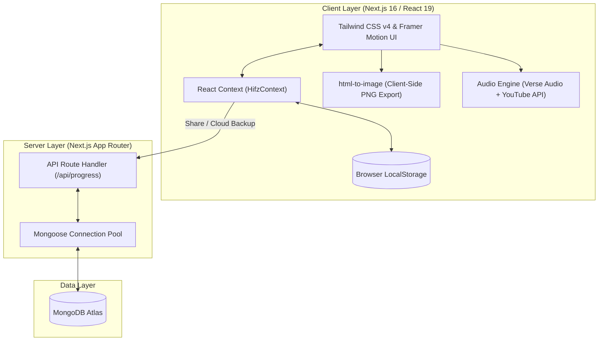

<div align="center">

  

  # 📖 Al-Hifzati (হিফজতি)
  ### *আমার কুরআন হিফজের পথচলা — A Modern Quran Memorization Companion*

  <p align="center">
    <strong>A high-performance, full-stack web application designed to track, celebrate, and share Quran memorization progress with spiritual elegance and modern web engineering.</strong>
  </p>

  <p align="center">
    <a href="https://al-hifzati.vercel.app/" target="_blank">
      
    </a>
  </p>

  <p align="center">
    
    
    
    
    
    
    
    
  </p>

  <p align="center">
    <a href="#-live-application">Live Demo</a> •
    <a href="#-executive-summary">Executive Summary</a> •
    <a href="#-target-audience--value-benefits">User Value & Benefits</a> •
    <a href="#-key-features">Key Features</a> •
    <a href="#-system-architecture--engineering-highlights">Engineering Highlights</a> •
    <a href="#-tech-stack">Tech Stack</a> •
    <a href="#-api-reference">API Reference</a> •
    <a href="#-getting-started">Getting Started</a>
  </p>

</div>

---

## 🌐 Live Application

Explore the deployed, production-grade application at:
👉 **[https://al-hifzati.vercel.app/](https://al-hifzati.vercel.app/)**

---

## 📌 Executive Summary

**Al-Hifzati** (*হিফজতি*) is an Islamic EdTech web application engineered to solve a widespread, real-world challenge: **tracking, structuring, and sustaining Quran memorization (Hifz)**.

Historically, learners and *Huffaz* (memorizers) rely on manual paper diaries, spreadsheets, or disjointed checklists to record memorized portions. These lack visual encouragement, revision utilities, and shareable milestones.

Al-Hifzati transforms this sacred journey into an engaging, dignified digital experience. Built upon **Next.js 16 (App Router)**, **React 19**, and **Tailwind CSS v4**, the application blends modern software architecture with Islamic geometric aesthetics, micro-interactions, client-side certificate generation, and verse-by-verse audio revision.

---

## 👥 Target Audience & Value Benefits

Designed with empathy for multiple user personas, Al-Hifzati delivers distinct personal, educational, and communal value:

| User Persona | Key Pain Point Addressed | Value & Realized Benefits |
| :--- | :--- | :--- |
| **Hifz Students & Memorizers** | Difficulty seeing big-picture progress across 114 Surahs and 6,236 Ayahs. | **Visual Milestones & Motivation**: Real-time progress percentage, Ayah count metrics, celebratory confetti animations, and milestone memory cards. |
| **Active Learners Revising Surahs** | Switching between separate tracking apps and Quran reading/audio tools. | **Integrated Study Suite**: Built-in interactive Surah reader with verse-by-verse audio recitations, Arabic font size toggling, and Bengali translations. |
| **Parents & Quran Teachers** | Tracking multiple children/students without intrusive supervision. | **Verifiable Progress Sharing**: Instant public share links (`/share/[id]`) and downloadable cards to monitor and appreciate student dedication. |
| **Everyday Muslims** | Overwhelmed by where to begin memorization. | **One-Click Batch Presets**: Instant shortcuts for "Amma Para" (Juz 30) or "Last 10 Surahs" to start small and build momentum. |

### Core User Benefits:
1. **Holistic Progress Transparency**: Understand exactly how much of the Quran is completed, remaining Surahs, and total Ayahs mastered.
2. **Offline-First Resilience**: Progress persists seamlessly across device refreshes through localized caching, requiring zero login barrier to get started.
3. **Shareable Achievement Cards**: Export professionally rendered, multi-themed achievement cards (`.png`) or unique URLs to share milestones with family and community.
4. **Distraction-Free Environment**: Calming Islamic dark-mode aesthetic with ambient spiritual audio to maintain focus and tranquility.
5. **Installable Anywhere**: Full Progressive Web App (PWA) support allowing mobile and desktop installation with native-app feel.

---

## 💎 Key Features & Capabilities

### 1. 📊 Interactive 114-Surah Dashboard
* **Dynamic Search & Multi-Criteria Filtering**: Search seamlessly across Bengali names, Arabic text, phonetic transliterations, or Surah numbers. Filter by *Makki*, *Madani*, *Memorized*, or *Remaining*.
* **Batch Operations**: One-click actions to toggle entire sections like **Amma Para (Juz 30)** or the **Last 10 Surahs**.
* **Real-Time Analytics**: Automatic computation of total memorized Surahs, cumulative Ayahs, and completion percentages.

### 2. 📖 Dedicated Surah Study & Revision Mode (`/surahs/[id]`)
* **Verse-by-Verse Audio Playback**: Integrated audio streaming for individual Ayahs with repeat and autoplay controls.
* **Bilingual Experience**: Original Arabic calligraphy with clear Bengali translation toggles.
* **Custom Typography**: Dynamic Arabic font scaling (`Normal`, `Large`, `Extra Large`) tailored for readable recitation on any screen.
* **Instant Status Toggle**: Mark individual Surahs as memorized directly from the reading view.

### 3. 🎨 Client-Side Achievement Card Generator (`/result`)
* **DOM-to-PNG Canvas Rendering**: Powered by `html-to-image`, users can generate and download high-resolution memory cards directly in the browser without server load.
* **5 Bespoke Design Themes**:
  * 🌿 **Green (সবুজ)**: Deep emerald Quranic gradient with warm gold accents.
  * 🌙 **Night (রাত)**: Slate-blue modern dark mode.
  * ⚪ **Minimal (মিনিমাল)**: Clean, high-contrast monochrome design.
  * 🕌 **Islamic (ইসলামিক)**: Sacred teal geometry with ornate borders.
  * ✨ **Gold (সোনালী)**: Luxury royal gold gradient for major milestone completions.
* **Social & Link Sharing**: One-click clipboard copy of progress summaries and direct Web Share API integration.

### 4. ☁️ Dual-Layer Data Persistence (Local-First + MongoDB Cloud)
* **Instant Local Storage**: Instant load times with zero friction; no sign-in wall required for personal tracking.
* **Cloud Sync for Public Sharing**: Automatically persists progress snapshots to MongoDB via serverless API routes, generating unique shareable permalinks (`/share/[id]`).

### 5. 🎵 Ambient Spiritual Audio Player
* Background Quranic ambient audio powered by an optimized, non-intrusive YouTube IFrame engine with play/pause and mute controls.

### 6. 📱 Progressive Web App (PWA) & Responsive Design
* Configured with Web App Manifest, standalone display mode, custom app icons, and theme color optimization for Android and iOS home screen installation.
* Lenis smooth-scrolling engine for fluid navigation across devices.

---

## 🏗️ System Architecture & Engineering Highlights

For Technical Recruiters, Engineering Managers, and Evaluators:



### Why These Architectural Choices?
* **Next.js 16 (App Router) + Turbopack**: Blazing-fast compilation times, optimized bundle splitting, and zero-runtime server component overhead.
* **React 19 & Context Architecture**: Built with modern hooks and hydration-resilient patterns, eliminating hydration mismatches between server-rendered HTML and client `localStorage`.
* **Tailwind CSS v4**: Utilizes the modern CSS engine with zero-config `@theme` directives, significantly reducing compiled CSS payload.
* **Client-Side Image Synthesis**: Generating cards on the client via canvas/DOM rendering saves significant server memory and compute compared to headless browser solutions (like Puppeteer).
* **Graceful Degradation**: If MongoDB environment credentials are not present, the app automatically falls back to an offline-first storage mode without throwing runtime errors.

---

## 🛠️ Tech Stack & Dependencies

| Layer | Technologies | Purpose |
| :--- | :--- | :--- |
| **Framework** | **Next.js 16** (App Router) | Server-side rendering, routing, static optimization |
| **UI Library** | **React 19** | Modern component-driven UI architecture |
| **Language** | **TypeScript 5** | Strict type safety, clean domain models |
| **Styling** | **Tailwind CSS v4** | Modern utility-first responsive styling |
| **Animation** | **Framer Motion 14** & **Canvas Confetti** | Smooth transitions, page load animations, celebratory triggers |
| **Database & ODM** | **MongoDB** & **Mongoose 9** | Cloud storage for shareable progress snapshots |
| **Image Generation** | **html-to-image** | High-definition client-side DOM-to-PNG export |
| **Icons** | **Lucide React** | Clean, lightweight icon suite |
| **Smooth Scrolling** | **Lenis** | Momentum-based silky-smooth scrolling experience |
| **Deployment** | **Vercel** | Global edge CDN, automated CI/CD pipeline |

---

## 📡 API Reference

The application includes serverless API endpoints to support cloud persistence and public sharing:

### 1. Save / Create Progress Snapshot
```http
POST /api/progress
Content-Type: application/json
```
**Request Payload:**
```json
{
  "userName": "Md: Eyasin Arafat",
  "userAvatar": "https://example.com/avatar.jpg",
  "selectedSurahIds": [1, 112, 113, 114],
  "totalMemorizedCount": 4,
  "totalAyahsMemorized": 19,
  "percentageCompleted": 3.51
}
```

### 2. Fetch Progress by ID
```http
GET /api/progress?id=65a7f9b...
```
**Response:**
```json
{
  "success": true,
  "data": {
    "_id": "65a7f9b...",
    "userName": "Md: Eyasin Arafat",
    "selectedSurahIds": [1, 112, 113, 114],
    "totalMemorizedCount": 4,
    "percentageCompleted": 3.51,
    "createdAt": "2026-03-20T10:00:00.000Z"
  }
}
```

---

## 📂 Project Directory Structure

```text
hifzati-app/
├── public/                 # Static assets, logos, and PWA icon definitions
├── src/
│   ├── app/                # Next.js 16 App Router
│   │   ├── api/progress/   # REST API route handlers (POST, GET)
│   │   ├── result/         # Progress summary & certificate card generator
│   │   ├── setup/          # User profile customization & avatar setup
│   │   ├── share/[id]/     # Dynamic public shareable progress pages
│   │   ├── surahs/         # Quran Surah directory & interactive browser
│   │   │   └── [id]/       # Detailed Ayah reading & audio revision mode
│   │   ├── globals.css     # Global theme configuration & Tailwind v4 styles
│   │   ├── layout.tsx      # Root layout with providers, audio, and SEO metadata
│   │   ├── manifest.ts     # Progressive Web App (PWA) manifest configuration
│   │   └── page.tsx        # High-conversion Islamic aesthetic Landing Page
│   ├── components/         # Reusable UI component modules
│   │   ├── BackgroundAudio.tsx     # Ambient spiritual audio background player
│   │   ├── Navbar.tsx              # Sticky header with quick progress badge
│   │   ├── ShareCard.tsx           # Multi-theme downloadable memory card
│   │   ├── SurahCard.tsx           # Interactive Surah card with quick-toggle
│   │   ├── SmoothScroll.tsx        # Lenis momentum smooth scroll wrapper
│   │   └── Footer.tsx              # Brand footer with prophetic citation
│   ├── context/            # React Context API for global state management
│   │   └── HifzContext.tsx # Centralized memorization tracker with LocalStorage sync
│   ├── data/               # Static Quran dataset
│   │   └── surahs.ts       # 114 Surahs metadata (Names, Ayah counts, Revelations)
│   ├── lib/                # Database utilities
│   │   └── db.ts           # Mongoose cached connection pool for serverless environments
│   └── models/             # Mongoose schemas & TypeScript interfaces
│       └── UserProgress.ts # User progress document definition
├── package.json            # Project dependencies and script runner
├── tsconfig.json           # TypeScript configuration
└── next.config.ts          # Next.js optimization and image remote patterns
```

---

## 🚀 Getting Started & Local Development

Follow these steps to set up and run the project locally on your machine:

### Prerequisites
* **Node.js**: `v18.18.0` or higher (Node 20+ recommended)
* **npm**, **pnpm**, or **yarn**
* *(Optional)* MongoDB connection string (local or MongoDB Atlas)

### Installation Steps

1. **Clone the repository**:
   ```bash
   git clone https://github.com/your-username/hifzati.git
   cd hifzati
   ```

2. **Install project dependencies**:
   ```bash
   npm install
   # or
   pnpm install
   ```

3. **Configure Environment Variables**:
   Create a `.env.local` file in the root directory:
   ```env
   # Optional: MongoDB connection for cloud saving & public share links
   MONGODB_URI=mongodb+srv://<username>:<password>@cluster.mongodb.net/hifzati?retryWrites=true&w=majority
   ```
   > *Note: If `MONGODB_URI` is omitted, the application will automatically function in standalone local-storage mode.*

4. **Start the Turbopack Development Server**:
   ```bash
   npm run dev
   ```

5. **Open in Browser**:
   Navigate to [http://localhost:3000](http://localhost:3000) to view the application.

---

## ⚡ Performance, UX & Quality Highlights

* **Zero Layout Shift (CLS)**: Structured with fixed aspect-ratio placeholders and custom fonts loaded via Next.js Font optimization.
* **Hydration Safety**: Defensive client-side state initialization avoiding SSR-client mismatch errors (`suppressHydrationWarning` and `isLoaded` guards).
* **Mobile-First Responsive Layouts**: Tested across multiple viewports—from compact mobile screens (320px) to ultra-wide displays.
* **Modern CSS Tokens**: Tailwind CSS v4 variables with high-contrast emerald and gold palettes compliant with accessibility guidelines.

---

## 🗺️ Future Roadmap

- [ ] **Spaced Repetition Algorithm (SRS)**: Smart revision scheduler alerting users when previously memorized Surahs need review.
- [ ] **Voice Note Self-Evaluation**: In-browser audio recording allowing users to record their recitation and cross-verify with Ayahs.
- [ ] **Multiple Reciter Selection**: Choose from renowned Qaris (Mishary Rashid Alafasy, Abdul Basit, Mahmoud Khalil Al-Husary).
- [ ] **Multi-language Support**: English, Urdu, and Turkish localization for international Muslim communities.

---

## 📄 License & Attribution

This project is licensed under the **MIT License** — feel free to use, modify, and learn from this codebase.

> *“The best among you are those who learn the Quran and teach it.”*  
> — **Sahih al-Bukhari: 5027**

<div align="center">
  <sub>Developed with dedication by <strong>Md: Eyasin Arafat</strong> • Powered by <strong>Next.js 16</strong></sub>
</div>
